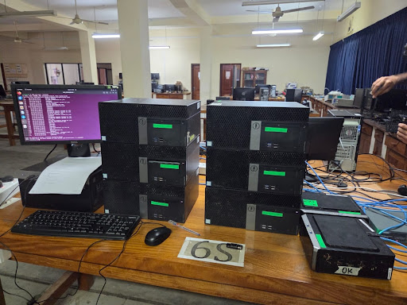
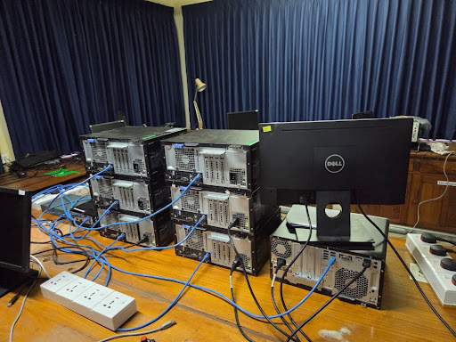
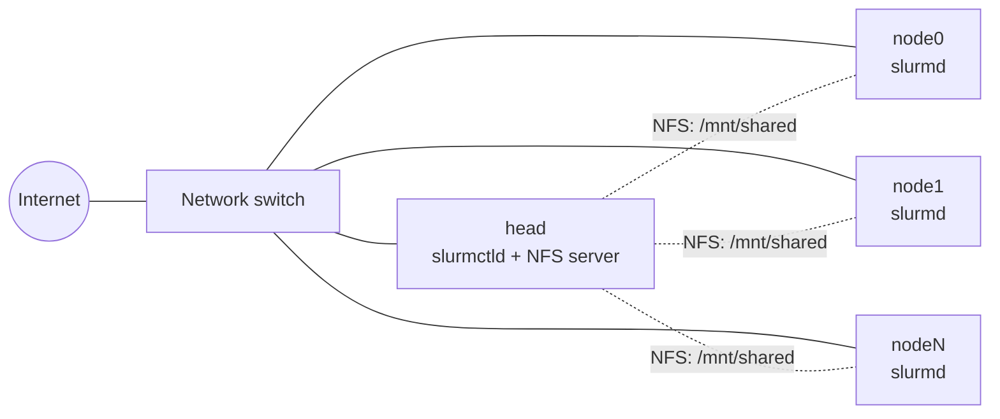

# Slurm Cluster Setup Scripts

Three Bash scripts that turn fresh Ubuntu machines into a working **Slurm** cluster: one head node plus any number of workers, with static networking, time sync, passwordless SSH, Munge authentication and shared NFS storage.

Built for a Physics lab computational cluster. Every step prints a clear `[ OK ]` / `[WARN]` / `[FAIL]` message with a hint on how to fix it, and the scripts are safe to re-run. A fourth, optional script (`node-setup-in-head.sh`) repairs nodes that were set up with an older version.

> Want to understand every step by hand first? See the original manual guide: [Setting Up a Slurm Cluster: Complete Beginners Guide](https://github.com/sahan-maker). These scripts automate that guide.

---

## Table of Contents

1. [The Cluster](#the-cluster)
2. [Repository Layout](#repository-layout)
3. [Requirements](#requirements)
4. [BIOS Setup: Boot Menu and Auto Power-On](#bios-setup-boot-menu-and-auto-power-on)
5. [Cluster Setup Generator (optional)](#cluster-setup-generator-optional)
6. [Step-by-Step Installation](#step-by-step-installation)
7. [Adding or Repairing a Single Node](#adding-or-repairing-a-single-node)
8. [Built-in Error Handling](#built-in-error-handling)
9. [Script Reference](#script-reference)
10. [Verify the Cluster](#verify-the-cluster)
11. [Troubleshooting](#troubleshooting)
12. [Credits and Contributing](#credits-and-contributing)

---

## The Cluster

Desktop PCs stacked on a lab bench and wired to one network switch. One machine is the **head node** (monitor and keyboard attached); the others are headless **workers**.

| Front view | Rear view (cabling) |
| :---: | :---: |
|  |  |



| Component | Runs on | Purpose |
| :--- | :--- | :--- |
| `slurmctld` | Head | Scheduler / controller |
| `slurmd` | Workers | Runs the jobs |
| Munge | All machines | Authentication (one shared key) |
| NFS `/mnt/shared` | Head exports, workers mount | Shared storage for job scripts and output |
| Chrony | All machines | Time sync (clock differences break Munge) |

---

## Repository Layout

```
.
├── README.md
├── Cluster Setup Generator.html   # optional: pre-fills the script questions
├── scripts/
│   ├── node-setup.sh              # run on every worker (first)
│   ├── head-setup.sh              # run on the head
│   ├── slurm-setup.sh             # run on the head (last)
│   └── node-setup-in-head.sh      # optional: head-setup.sh + turns off automatic upgrades on all machines
└── images/
    ├── cluster-front.jpg
    └── cluster-rear.jpg
```

On the USB drive, put the scripts in a folder named **`Slurm`** (the commands below use `/mnt/usb/Slurm/`).

---

## Requirements

- Ubuntu 22.04 LTS
  - Head: Desktop (GUI) edition, so you can open the Slurm configurator in a browser
  - Workers: Server edition (no GUI)
- Head hostname must be exactly **`head`**; workers use a prefix and a number (`node0`, `node1`, ...)
- **The same username and password on every machine** (script default: `elec_cluster`)
- All machines connected to one network switch with internet access
- A free static IP for the head and for every worker (ask your network admin)
- A USB drive to carry the scripts to the machines

---

## BIOS Setup: Boot Menu and Auto Power-On

Do this **once on every machine** (head and workers) before or right after installing Ubuntu. The cluster in the photos uses Dell desktops; menu names below are for Dell BIOS and can differ slightly between models and BIOS versions. Other brands have the same options under similar names.

### 1. Boot menu (to boot from the USB installer)

1. Power on the PC and repeatedly tap **F12** (one-time boot menu on Dell).
2. Choose your USB drive from the list and press Enter.

Other common keys: **F2** or **Del** opens the full BIOS setup; **Esc**, **F9**, **F10** or **F11** open the boot menu on other brands.

### 2. Power management: AC Recovery (power back on after a power cut)

By default most PCs stay off after the power is cut and restored. With **AC Recovery** set correctly, every PC starts by itself when the plug gets power again. This matters for a cluster that runs unattended.

1. Tap **F2** at startup to enter BIOS setup.
2. Go to **Power Management** (called **Power** on some models).
3. Find **AC Recovery** (also shown as *AC Power Recovery*, *Restore on AC Power Loss* or *After Power Loss*).
4. Set it to **Power On**.

   | Option | Behaviour |
   | :--- | :--- |
   | Power Off | Stays off when power returns (default on most machines) |
   | **Power On** | **Starts automatically when power returns (use this)** |
   | Last Power State | Returns to whatever it was doing before the cut |

   *Last Power State* also works, but a machine that was switched off will then stay off. **Power On** is the safest choice for a cluster.
5. Save and exit (**F10**, or **Apply Changes** then **Exit**).

Optional settings in the same menu:

- **AC Recovery Time** or **Auto On Time** (if your BIOS has it): add a small delay, or a different delay per machine, so all PCs do not draw their start-up current at the same moment.
- **Deep Sleep Control**: leave it disabled if you want the PC to start reliably after power returns.
- **Wake on LAN**: enable it if you also want to power machines on remotely over the network.

### 3. Test it

1. Shut the PC down, then unplug the power cable (or switch off the power strip).
2. Wait about 10 seconds and plug it back in.
3. The PC should power on by itself without pressing the power button.

### After a power cut: what starts by itself

- `slurmd` (workers) and `slurmctld` (head) are enabled by the setup scripts, so they start on boot.
- The workers mount `head:/mnt/shared` with the `nofail` option. If a worker boots **before** the head is ready, the mount can fail at boot and the machine still starts normally. When the head is up, run this on the worker:

  ```bash
  sudo mount -a
  ```

  or simply reboot the worker.
- If a node shows `down` or `unk*` in `sinfo` after the cluster is back, see [Troubleshooting](#troubleshooting).

---

## Cluster Setup Generator (optional)

`Cluster Setup Generator.html` lets you type your cluster details **once** so the scripts do not ask you again. This reduces the interaction time during setup.

### How to use it

1. Open the page and enter these once:
   - cluster user
   - head IP
   - node0 IP
   - node name prefix
   - first node index and how many nodes
   - gateway and DNS (they are filled in for you and you can edit them)
   - netmask bits
2. Click **Download all 3 scripts (.zip)**, then run:

   ```bash
   unzip cluster-scripts.zip
   ```

   It is a zip because the page cannot download `.sh` files on their own. If the download is blocked, the page has a copy button for each script.
3. Put the three scripts in the **`Slurm`** folder on your USB drive and continue with the [installation steps](#step-by-step-installation).

### What each script still asks you (generated scripts)

| Script | What it still asks |
| :--- | :--- |
| `node-setup.sh` (on each worker) | Only the node name, e.g. `node3`. Node IP, gateway, DNS and interface come from your values, and the final "Continue?" question is removed. |
| `head-setup.sh` | Only the password. The "Continue?" question is removed. |
| `slurm-setup.sh` | Only the password. |

**Automatic updates:** `node-setup.sh` turns off automatic updates on each worker. It disables and masks the `apt-daily` timers and `unattended-upgrades`, and writes `20auto-upgrades` with zeros. The scripts in `scripts/` do this too.

**Unchanged:** the generated scripts are the original scripts with the typed questions replaced by your values, so all checks and messages are the same. One question is kept on purpose: the duplicate-IP warning in `node-setup.sh`, because that needs a human decision.

**Run order:** `node-setup.sh` on every worker, then `head-setup.sh`, then create `slurm.conf`, then `slurm-setup.sh`.

> The scripts in `scripts/` are the interactive versions and ask every question. Use the generator if you want fewer prompts.

---

## Step-by-Step Installation

Run the steps **in this order**: all workers first, then the head, then `slurm.conf`, then `slurm-setup.sh`.

### Part A: Set up every worker node (one by one)

Do all of the following on **each worker**, then move to the next one.

**1. Install the operating system**

First set the BIOS options from [BIOS Setup](#bios-setup-boot-menu-and-auto-power-on) (boot menu key and **AC Recovery = Power On**). Then install Ubuntu Server 22.04 on the node. Use the same username and password as on every other machine, and give the node its own name (`node0`, `node1`, ...). Connect the node to the network switch with an Ethernet cable.

In the Ubuntu installer, fill in the profile screen like this:

| Installer field | What to enter |
| :--- | :--- |
| Your name | `Elec_Cluster` |
| Your server's name (the name it uses when it talks to other computers) | `node0` (then `node1`, `node2`, ... one per worker) |
| Pick a username | `elec_cluster` |
| Choose a password | Your cluster password (the **same on every machine**) |
| Confirm your password | The same password again |

The username and password must be identical on the head and on every worker, because the scripts log in to all machines with them. Only the server name changes from node to node.

**2. Plug in the USB drive and find it with `lsblk`**

```bash
lsblk
```

Example output:

```text
NAME   MAJ:MIN RM   SIZE RO TYPE MOUNTPOINTS
loop0    7:0    0  63.9M  1 loop /snap/core20/2318
sda      8:0    0 238.5G  0 disk
├─sda1   8:1    0     1G  0 part /boot/efi
└─sda2   8:2    0 237.4G  0 part /
sdb      8:16   1   7.3G  0 disk
└─sdb1   8:17   1   7.3G  0 part
```

How to pick the USB partition:

- The USB drive is the disk with **`RM` = 1** (removable) and a size that matches your flash drive (here `sdb`, 7.3 GB).
- Use its **partition** (`TYPE` = `part`) with no mount point yet, here **`sdb1`**.
- Do **not** pick `sda`: that is the computer's own disk (it has `/` and `/boot/efi` mounted).

Your USB may show up with a different name (for example `sdc1`). Use whatever `lsblk` shows for your drive.

**3. Create a folder to mount it on**

```bash
sudo mkdir -p /mnt/usb
```

**4. Mount the USB drive**

```bash
sudo mount /dev/sdb1 /mnt/usb
```

**5. Go to the scripts folder**

```bash
cd /mnt/usb/Slurm/
```

**6. Run the worker script**

```bash
sudo ./node-setup.sh
```

If you get `Permission denied` (some USB file systems do not keep the executable flag), run it this way instead:

```bash
sudo bash node-setup.sh
```

Answer the questions (with the generator you are only asked for the node name):

| Prompt | Example |
| :--- | :--- |
| Head IP | `10.40.52.183` |
| IP of node0 (first node) | `10.40.52.175` |
| This node's name | `node8` |
| Node IP | Press Enter to accept the calculated one, or type the real IP if this node does not follow the pattern |
| Gateway / DNS | Press Enter to accept the guess (`x.x.x.254` / `x.x.2.1`) or type your own |
| Network interface | Press Enter to accept the detected one |

How the node IP is calculated: node0's IP plus the node number, skipping the head's IP. With head `.183` and node0 `.175`: node7 = `.182`, node8 = `.184`, node9 = `.185`.

Before it touches the network, the script stops automatic upgrades and sleep on the node (step 2b). Automatic upgrades hold the apt lock and make later installs fail, and a sleeping node drops off the network.

**7. Reboot and check**

```bash
sudo reboot
# after it boots:
ip a        # the static IP should still be there
```

The reboot is not optional. If the script ends with `A REBOOT IS REQUIRED`, a kernel update is waiting, and without the reboot the NFS mount can fail later.

**8. Repeat for every worker node** (steps 1 to 7).

---

### Part B: Set up the head node

Once **all** workers are done, go to the head node.

**1.** Install Ubuntu 22.04 Desktop (GUI) on the head. Fill in the installer like this:

| Installer field | What to enter |
| :--- | :--- |
| Your name | `Elec_Cluster` |
| Your computer's name | `head` (it must be exactly `head`) |
| Pick a username | `elec_cluster` |
| Choose a password | The same cluster password as on the workers |
| Confirm your password | The same password again |

**2.** Plug in the USB drive and mount it the same way:

```bash
lsblk
sudo mkdir -p /mnt/usb
sudo mount /dev/sdb1 /mnt/usb
cd /mnt/usb/Slurm/
```

**3.** Run the head script as your **normal user** (not root, not `sudo`):

```bash
bash ./head-setup.sh
```

Enter your password when asked. (Without the generator it also asks: cluster user, head IP, node name prefix, first and last node index of the **whole cluster**, node0's IP, and whether to set up only one node. For the whole cluster just press Enter at that last question.)

For every worker it sets up passwordless SSH, Chrony, `/etc/hosts`, the Slurm packages, one shared Munge key (checked and tested in both directions), and NFS (`/mnt/shared` exported from the head and mounted on each worker). A summary table at the end shows which nodes are OK or FAILED. Fix any failed node and run the script again.

---

### Part C: Create `slurm.conf`

**1.** On the head, open the Slurm configurator in a web browser:

```bash
xdg-open /usr/share/doc/slurmctld/slurm-wlm-configurator.html
```

(or open `/usr/share/doc/slurmctld/slurm-wlm-configurator.html` from Firefox).

**2.** On a worker, run `lscpu` to get the hardware values, and `slurmd -C` to get the real `RealMemory`.

**3.** Fill in only these fields:

| Field | Value |
| :--- | :--- |
| ClusterName | Your cluster name |
| SlurmctldHost | `head` |
| NodeName | e.g. `node[0-7]` (must match your real node names) |
| CPUs, Sockets, CoresPerSocket, ThreadsPerCore | From `lscpu` |
| RealMemory | A little **below** the smallest value `slurmd -C` reports on any node |
| ProctrackType | `LinuxProc` |

If one node has different hardware (for example less RAM), give it its own `NodeName=` line. Otherwise Slurm marks it `inval`.

**4.** Click **Submit** and copy the text that appears.

**5.** Paste it into the config file on the head:

```bash
sudo nano /etc/slurm/slurm.conf
```

Save with `Ctrl+O`, `Enter`, then exit with `Ctrl+X`.

---

### Part D: Start Slurm

**1.** Go back to the scripts folder on the head (if you are not already there):

```bash
cd /mnt/usb/Slurm/
```

**2.** Run the final script as your **normal user**:

```bash
bash ./slurm-setup.sh
```

Enter your password when asked. It checks every node (SSH, `slurmd`, Munge key, clock), copies `slurm.conf` to each worker (checksum verified), creates the Slurm directories, starts `slurmd` on the workers and `slurmctld` on the head, then waits for the nodes to register and explains any node that is not `idle`. For the whole cluster, press Enter at the "Set up only ONE node?" question.

**3.** Check the cluster:

```bash
sinfo
```

All nodes should show **idle**. That is it, the cluster is ready.

---

## Adding or Repairing a Single Node

If one node was missing or broken (powered off, wrong IP, reinstalled), you do not need to set up the whole cluster again. `head-setup.sh` and `slurm-setup.sh` both have a single-node mode, and the other nodes are not touched.

1. **On the node:** run `sudo bash node-setup.sh`, then `sudo reboot`.
2. **On the head:** run `bash ./head-setup.sh`.
   - First and last node index: the **whole cluster** (for example `0` and `14`).
   - At `Set up only ONE node?` enter just the number, for example `14`.
   - It then asks for that node's IP. Press Enter to accept the calculated one, or type the real IP if the node does not follow the pattern.
3. **On the head:** run `bash ./slurm-setup.sh` and answer the same way.

What single-node mode does and does not do:

- `/etc/hosts` on the head and on the node still lists the whole cluster. The IPs head already has for the other nodes are kept; only the selected node's line is new or changed.
- If you edited `slurm.conf` (for example to add the new node), every node needs the new copy. In that case run `slurm-setup.sh` for the **whole cluster** (press Enter at the single-node question) so all nodes get the same file.
- A drained node with the old `NO NETWORK ADDRESS FOUND` flag is resumed automatically by `slurm-setup.sh`.

For nodes that were set up with an **older** `node-setup.sh` (one without step 2b), run `node-setup-in-head.sh` instead of `head-setup.sh`. It does everything `head-setup.sh` does and first turns off automatic upgrades on the head and on every selected node.

---

## Built-in Error Handling

The scripts were hardened against the errors that came up on a real 15-node cluster:

| Problem | What the scripts do |
| :--- | :--- |
| `Could not get lock /var/lib/dpkg/lock-frontend` (automatic upgrade running) | Every `apt-get` waits up to 5 minutes for the lock. `node-setup.sh` turns automatic upgrades off. |
| Misleading "no internet" hint | The hint reads the real apt error and tells apart: dpkg lock, interrupted install, and a real network problem. |
| A node drops off the network in the middle of a run | `head-setup.sh` checks each node is still reachable before every step. A lost node is marked FAILED and skipped instead of timing out in every step. `slurm-setup.sh` does the same check before it copies `slurm.conf`. |
| `mount.nfs: an incorrect mount option was specified` | The mount falls back to `modprobe nfs` and a plain NFS v4 mount. If it still fails, the script prints the kernel version, whether a reboot is pending, the real `mount -v` output and `dmesg`. A pending kernel update shows "reboot the node and re-run". |
| Pending kernel update | `node-setup.sh` warns at the end that a reboot is required. |
| Node sleeps or suspends | `node-setup.sh` disables sleep, suspend and hibernate targets. |
| Node reports `NO NETWORK ADDRESS FOUND` | `slurm-setup.sh` clears this old drain flag by resuming the node. |
| Node unreachable in `slurm-setup.sh` | It tells you if the node does not answer ping at all (power, cable, IP) or only SSH by key fails (run `head-setup.sh`). |

---

## Script Reference

| Script | Run on | Command | Run as | What it does |
| :--- | :--- | :--- | :--- | :--- |
| `node-setup.sh` | Each worker | `sudo ./node-setup.sh` | root (re-runs itself with sudo) | Stops automatic upgrades and sleep, static IP via netplan (with backup and automatic restore on failure), disables cloud-init network config, network tests, hostname, `/etc/hosts`, OpenSSH, `slurmd` + `slurm-client`, reboot-required warning |
| `head-setup.sh` | Head | `bash ./head-setup.sh` | normal user | Reachability check, passwordless SSH, Chrony, `/etc/hosts`, `slurm-wlm`, Munge key sync, NFS server and client mounts; optional single-node mode |
| `slurm-setup.sh` | Head | `bash ./slurm-setup.sh` | normal user | Pre-flight check per node, `slurm.conf` sync, directories, starts `slurmd` and `slurmctld`, node state report; optional single-node mode |
| `node-setup-in-head.sh` | Head | `bash ./node-setup-in-head.sh` | normal user | Same as `head-setup.sh`, plus turns off unattended-upgrades on the head and on every node before installing anything |

Notes:

- The scripts assume a **/24 network**.
- A node that fails an early check is skipped; the others continue, and a summary is printed at the end.
- The password you type is kept only in memory during the run and wiped on exit.
- Backups are kept: `/etc/hosts.bak` and `/etc/netplan/*.bak.<timestamp>`.
- `head-setup.sh` and `node-setup-in-head.sh` are alternatives. You do not need to run both.

---

## Verify the Cluster

```bash
sinfo                 # every node should show "idle"
srun -N8 hostname     # use your worker count; prints one hostname per node
```

Quick shared-storage check:

```bash
touch /mnt/shared/test && ls -l /mnt/shared
```

Run jobs from `/mnt/shared`, not from your home folder. `/home` is local to each machine and is not shared, so a job started from a home folder that does not exist on the node prints `couldn't chdir ... going to /tmp instead`.

Check that the share is really mounted on every node:

```bash
for n in node{0..14}; do echo -n "$n: "; ssh $n 'findmnt -n -o FSTYPE,SOURCE /mnt/shared || echo NOT MOUNTED'; done
```

---

## Troubleshooting

| Symptom | Likely cause | Fix |
| :--- | :--- | :--- |
| `sudo ./node-setup.sh`: Permission denied | USB file system does not keep the executable flag | Run `sudo bash node-setup.sh` |
| `node-setup.sh`: no link on the interface | Cable unplugged or switch off | Check the cable and switch power |
| `node-setup.sh`: IP "already answers ping" | Another machine uses that IP | Pick a free IP |
| `netplan apply` fails | Missing Open vSwitch package | The script installs `openvswitch-switch` and retries (needs internet) |
| `netplan apply` still fails | YAML error, two netplan files, or wrong permissions | `sudo netplan --debug apply` shows the error. Check `ls /etc/netplan/`, use `chmod 600 /etc/netplan/*.yaml`, and use `sudo netplan try` over SSH so a bad config rolls back by itself |
| `Could not get lock /var/lib/dpkg/lock-frontend` | An automatic upgrade is running (not a network problem) | Wait a few minutes and re-run. To stop it for good: `sudo systemctl disable --now unattended-upgrades apt-daily.timer apt-daily-upgrade.timer`, or run `node-setup-in-head.sh` |
| `head-setup.sh`: SSH port closed or no reply | Node off, wrong IP, or `node-setup.sh` not run | Run `node-setup.sh` on that node, check power and cable |
| `lost connection (SSH timed out)` in the middle of a run | Node powered off, rebooted, suspended, or its network dropped | Check power, cable and IP (`ping`, `ip a` on the node), then re-run |
| `ssh-copy-id` fails: "IDENTIFICATION HAS CHANGED" | Node was reinstalled | `ssh-keygen -R <node-ip>`, then re-run |
| `ssh-copy-id` fails: wrong password | Different password or username on the node | Use the same user and password everywhere |
| "munge rejected head's credential" | Different `munge.key` or clock skew | Re-run `head-setup.sh` (copies head's key); check `chrony` and `date` |
| NFS mount fails | Export or firewall problem | On head: `sudo exportfs -v`, `sudo ufw status`; on node: `showmount -e head` |
| `mount.nfs: an incorrect mount option was specified` | NFS kernel module missing after a kernel update that was never rebooted | Reboot the node (`sudo reboot`) and re-run. The script prints diagnostics that confirm this |
| Node shows `inval` | `CPUs` / `RealMemory` in `slurm.conf` exceed the hardware | Run `slurmd -C` on the node. Lower the values (keep `RealMemory` a little below the reported value) or give that node its own `NodeName=` line. Copy `slurm.conf` to all nodes (re-run `slurm-setup.sh`), then `sudo scontrol update nodename=<node> state=resume` |
| Node drained with `NO NETWORK ADDRESS FOUND` | Flag set before the name resolved | `slurm-setup.sh` clears it. Manually: `getent hosts <node>`, then `sudo scontrol update nodename=<node> state=resume` |
| Node shows `down` / `unk*` | `slurmd` cannot reach `slurmctld` | `ping head` from the node, check `ufw status`, `sudo journalctl -u slurmd -n 20` |
| Job prints `couldn't chdir ... going to /tmp instead` | The job was started from a folder that exists only on head (such as `/home/<user>/...`) | Start jobs from `/mnt/shared` |
| Job stuck in `PD` | No free resources or node drained | `scontrol show job <id>` |
| `slurmctld` stops right after start | Error in `slurm.conf`, wrong `SlurmctldHost`, Munge problem | `sudo journalctl -u slurmctld -n 20` |

Useful logs:

```bash
sudo journalctl -u slurmctld -f
sudo journalctl -u slurmd -f
sudo tail -f /var/log/slurm/slurmctld.log
```

---

## Credits and Contributing

- Original guide and cluster build: **Sahan Prathibha Wijethunga** ([sahanprathibhawije@gmail.com](mailto:sahanprathibhawije@gmail.com))
- Scripts and updates: **Meshan Nawod** ([meshannawodme@gmail.com](mailto:meshannawodme@gmail.com))
- Fork and customise the defaults (user, subnet, packages) for your own infrastructure. Issues and pull requests are welcome.
